# Study Plan Recommender (SPR) - Comprehensive System Diagrams Portfolio
**Author**: Academic Chair & System Architecture Team  
**Institution**: PT3 Solutions Academic Repository  
**Version**: 2.0 (Official Release)  

---

## 19. Entity Relationship Diagram (Crow's Foot Notation)

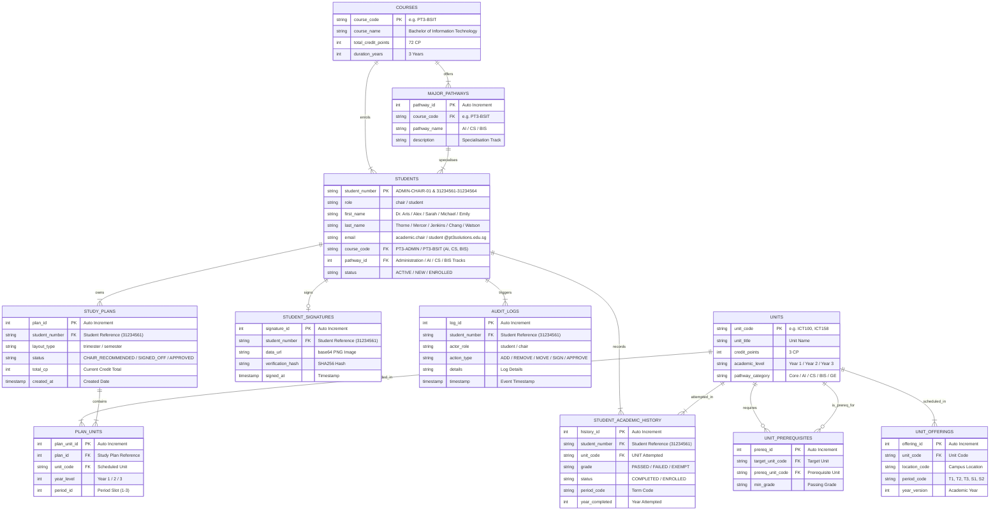

---

## 20. Overall SPR Process Flow

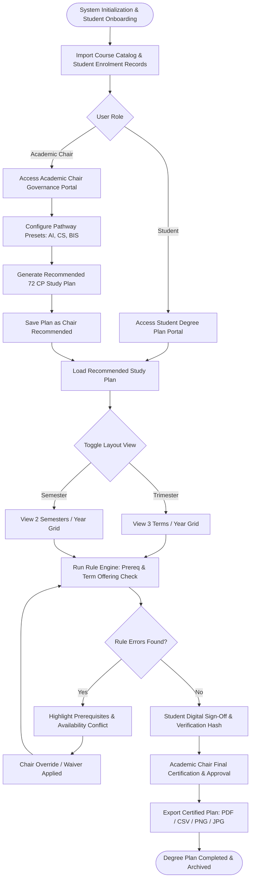

---

## 21. New-Student Plan Generation Flow

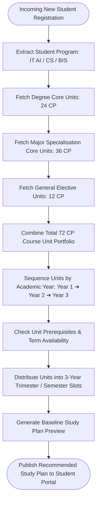

---

## 22. Existing-Student Plan Revision Flow

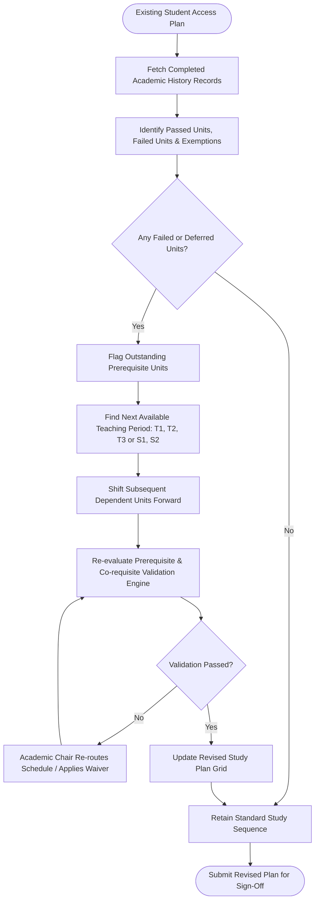

---

## 23. Study-Plan State-Transition Diagram

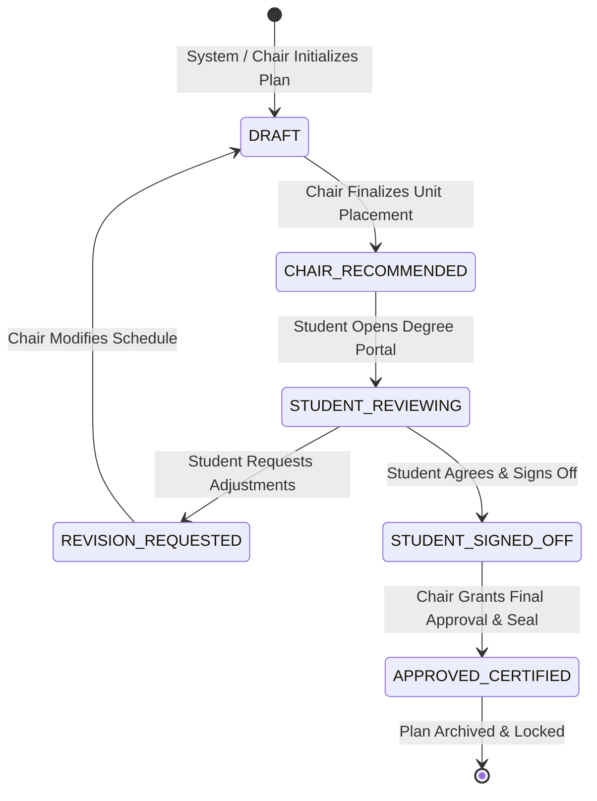

---

## 24. Prerequisite Validation and Waiver Flow

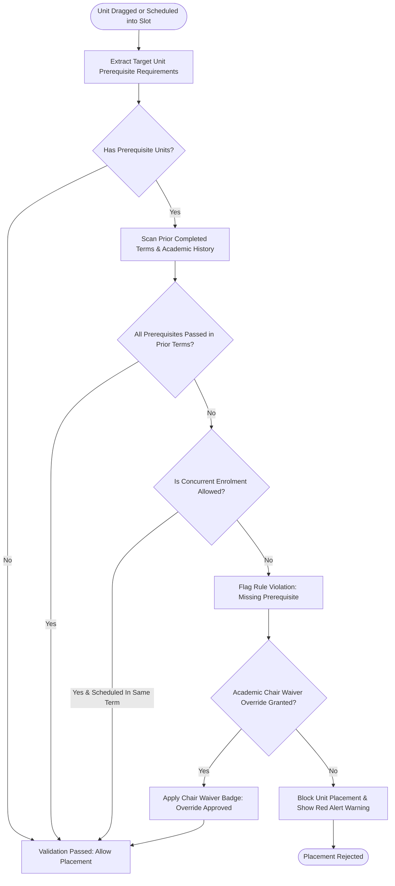

---

## 25. Unit Offering Validation Flow

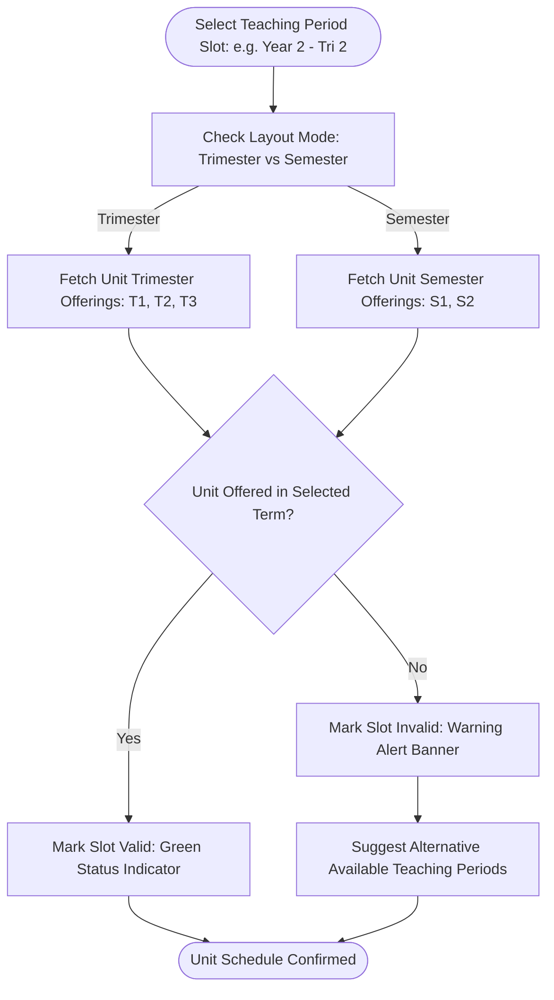

---

## 26. Three-Tier Architecture Diagram

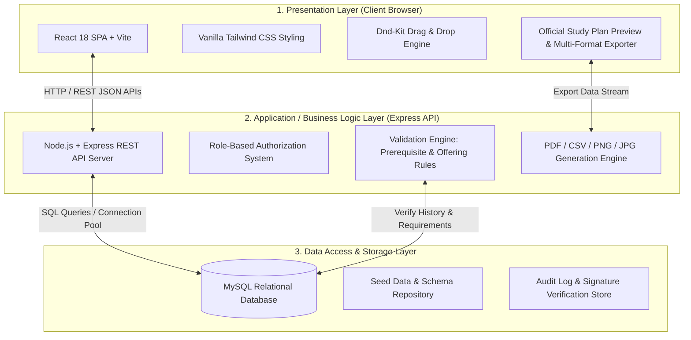

---

## 27. Academic Chair Navigation / Screen Map

```mermaid
graph TD
    ChairPortal[Academic Chair Master Workspace] --> Dashboard[Governance Overview Dashboard]
    
    ChairPortal --> CatalogTab[Course Catalog Management]
    CatalogTab --> MasterDirectory[Master Unit Directory]
    CatalogTab --> MajorTabs[AI / CS / BIS Pathway Tabs]
    CatalogTab --> GeneralElectives[General Electives Tab]
    CatalogTab --> ImportEngine[Universal Dataset Import Engine CSV/Excel]
    CatalogTab --> AddUnitModal[Add / Edit Unit Modal]
    
    ChairPortal --> StudentTab[Student Roster & Degree Plans]
    StudentTab --> StudentSelector[Student Selector & Search Bar]
    StudentTab --> StudentHistory[Academic History & Transcripts]
    
    ChairPortal --> CanvasTab[Study Plan Builder Canvas]
    CanvasTab --> LayoutSwitcher[Trimester / Semester Layout Switcher]
    CanvasTab --> YearNav[Year Slide Navigation: Year 1 / 2 / 3]
    CanvasTab --> PresetBtn[Auto-Fill Major Presets]
    CanvasTab --> ExportBtn[Export Official Document PDF/CSV/PNG/JPG]
    
    ChairPortal --> AuditTab[Audit Log & Change Tracking]
    AuditTab --> RoleFilter[Filter by Student / Chair Actions]
```

---

## 28. Student Navigation / Screen Map

```mermaid
flowchart LR
    %% Subgraph 1: Student View (Restricted Context)
    subgraph S_View["4. Student View (Restricted Context)"]
        direction TB
        S_Context["Student Account Security Context:<br/>Locked to Enrolled Major Track<br/>(Cross-Student Switching Blocked)"]
        S_Nav["Filtered Navigation Bar"]
        S_Header["Dynamic Header Profile:<br/>Name, Student ID, Major & Status"]
        S_Notif["Student Notifications & Chair Updates"]
        S_LayoutActions["Layout Actions:<br/>Chair Session & Bypass"]
        S_SingleClass["Single Permanent Class Demonstration"]

        S_Nav --> S_Header
        S_Nav --> S_Notif
        S_Nav --> S_LayoutActions
        S_Nav --> S_SingleClass
        S_Context --> S_Nav
    end

    %% Subgraph 2: Multi-User Authentication Flow
    subgraph S_Auth["1. Multi-User Authentication"]
        direction TB
        A_SSO["PT3 Solutions<br/>SSO Login Portal"]
        A_Creds["Input Student Credentials:<br/>• <b>Alex Mercer</b> (31234561 / alex123) [AI]<br/>• <b>Sarah Jenkins</b> (31234562 / sarah123) [CS]<br/>• <b>Michael Chang</b> (31234563 / michael123) [BIS]<br/>• <b>Emily Watson</b> (31234564 / emily123) [AI]"]
        A_Valid["Access Public Session<br/>Validation"]
        A_Portal["Student Study Plan Portal<br/>(Restricted to Authenticated Student)"]

        A_SSO --> A_Creds
        A_Creds --> A_Valid
        A_Valid --> A_Portal
    end

    %% Subgraph 3: Interactive Study Plan Canvas
    subgraph S_Canvas["2. Interactive Study Plan Canvas"]
        direction TB
        C_Palette["Course Unit Palette"]
        C_Filter["Unit Search &<br/>Category Filter"]
        C_Drag["Draggable Unit Cards"]
        C_Switcher{"Layout Switcher"}
        C_TriGrid["3 Terms / 1 Year<br/>Canvas Grid (Trimester)"]
        C_SemGrid["2 Semesters / 1 Year<br/>Canvas Grid (Semester)"]

        C_Palette --> C_Filter
        C_Palette --> C_Drag
        C_Drag --> C_TriGrid
        C_Drag --> C_SemGrid
        C_Switcher -->|Trimester| C_TriGrid
        C_Switcher -->|Semester| C_SemGrid
    end

    %% Subgraph 4: Student Action Bar & Document Export
    subgraph S_Actions["3. Student Action Bar & Document Export"]
        direction TB
        ACT_Toolbar["Student Action Toolbar"]
        ACT_NewReq["Submit Plan Request to Chair<br/>(New Students: Michael / Emily)"]
        ACT_Signature["Digital Signature Pad:<br/>Agree, Sign & Generate Hash<br/>(Existing Students: Alex / Sarah)"]
        ACT_Export["Export Document & Preview Modal"]
        ACT_Revise["Submit Revised Plan to Chair:<br/>View Audit Log / Academic History"]
        
        ACT_Format{"Format Selector"}
        EXP_PDF["Official Accreditation Print (PDF)"]
        EXP_CSV["CSV Spreadsheet Export Data"]
        EXP_IMG["High-Res Degree Map (PNG / JPG)"]

        ACT_Toolbar --> ACT_NewReq
        ACT_Toolbar --> ACT_Signature
        ACT_Toolbar --> ACT_Export
        ACT_Toolbar --> ACT_Revise
        ACT_Export --> ACT_Format
        ACT_Format -->|PDF| EXP_PDF
        ACT_Format -->|CSV| EXP_CSV
        ACT_Format -->|PNG / JPG| EXP_IMG
    end

    %% Inter-subgraph Transitions
    A_Portal --> S_Context
    A_Portal --> C_Palette
    A_Portal --> C_Switcher
    S_LayoutActions --> C_Switcher

    C_TriGrid --> ACT_Toolbar
    C_SemGrid --> ACT_Toolbar

    %% Aesthetic Class Definitions
    classDef navStyle fill:#0a192f,stroke:#38bdf8,stroke-width:1.5px,color:#ffffff;
    classDef authStyle fill:#1e1b4b,stroke:#c026d3,stroke-width:2px,color:#ffffff;
    classDef canvasStyle fill:#0f172a,stroke:#38bdf8,stroke-width:1.5px,color:#ffffff;
    classDef switchStyle fill:#0369a1,stroke:#38bdf8,stroke-width:2px,color:#ffffff;
    classDef actionStyle fill:#064e3b,stroke:#10b981,stroke-width:2px,color:#ffffff;
    classDef formatStyle fill:#065f46,stroke:#34d399,stroke-width:2px,color:#ffffff;
    classDef exportStyle fill:#1f2937,stroke:#64748b,stroke-width:1.5px,color:#ffffff;

    class S_Context,S_Nav,S_Header,S_Notif,S_LayoutActions,S_SingleClass navStyle;
    class A_SSO,A_Creds,A_Valid,A_Portal authStyle;
    class C_Palette,C_Filter,C_Drag,C_TriGrid,C_SemGrid canvasStyle;
    class C_Switcher switchStyle;
    class ACT_Toolbar,ACT_NewReq,ACT_Signature,ACT_Export,ACT_Revise actionStyle;
    class ACT_Format formatStyle;
    class EXP_PDF,EXP_CSV,EXP_IMG exportStyle;

    style S_View fill:#f0fdfa,stroke:#0d9488,stroke-width:2px;
    style S_Auth fill:#fdf4ff,stroke:#d946ef,stroke-width:2px;
    style S_Canvas fill:#fff7ed,stroke:#f97316,stroke-width:2px;
    style S_Actions fill:#f0fdf4,stroke:#06b6d4,stroke-width:2px;
```

---

## 29. Sequence Diagram for Recommend ➔ Student Review ➔ Final Approval

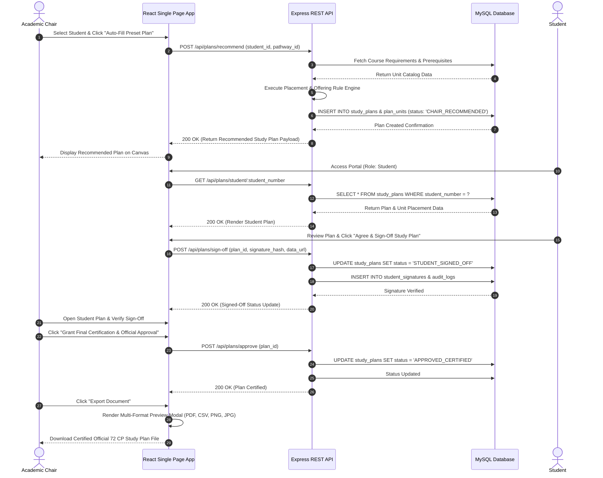
